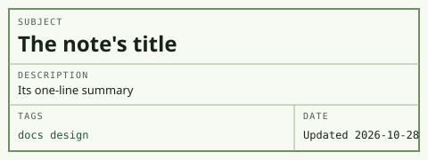

I call the design Engineering Pad, after the green, gridded computation paper engineers used to work problems out on. It's built for my phone first, and it turns into a blueprint when the device is in dark mode.

## The parts of a page

### Title block

The box at the top of every note works like the title block on a drawing: Subject, Description, Tags, and Date. Each one comes straight from the front matter (see [Writing a Note](writing-a-note.md)).



### Numbered sections

Sections are numbered 1, 1.1, 1.2, and so on, like a specification, so "see 2.1" actually means something. The contents box uses the same numbers. On a wide screen it sits beside the text and marks the section you're reading.

## Everything a note can contain

### Lists and tasks

- A bullet, drawn as a dash.
- A second bullet, with a [link](how-search-works.md).

- [x] A finished task gets a drafting X.
- [ ] An open task is an empty box.

### Tables

| Element | Drawn as |
|---|---|
| Section heading | Capitals over a rule |
| Break within a section | A dimension line |
| Table | A solid box, scrolling sideways on a phone |

### Quotes, code, and footnotes

> A quote sits behind a ruled line, in italics.

Inline `code` and code blocks are set in IBM Plex Mono:

```js
const note = parseNote(text);
```

Footnotes collect at the bottom of the note.[^1]

---

### Type

I use three cuts of IBM Plex: Sans for reading, Sans Condensed for headings, and Mono for labels, dates, and tags. All of it is self-hosted, and everything scales from one root size, which I set 40% larger than the browser default.

[^1]: Like this one.
